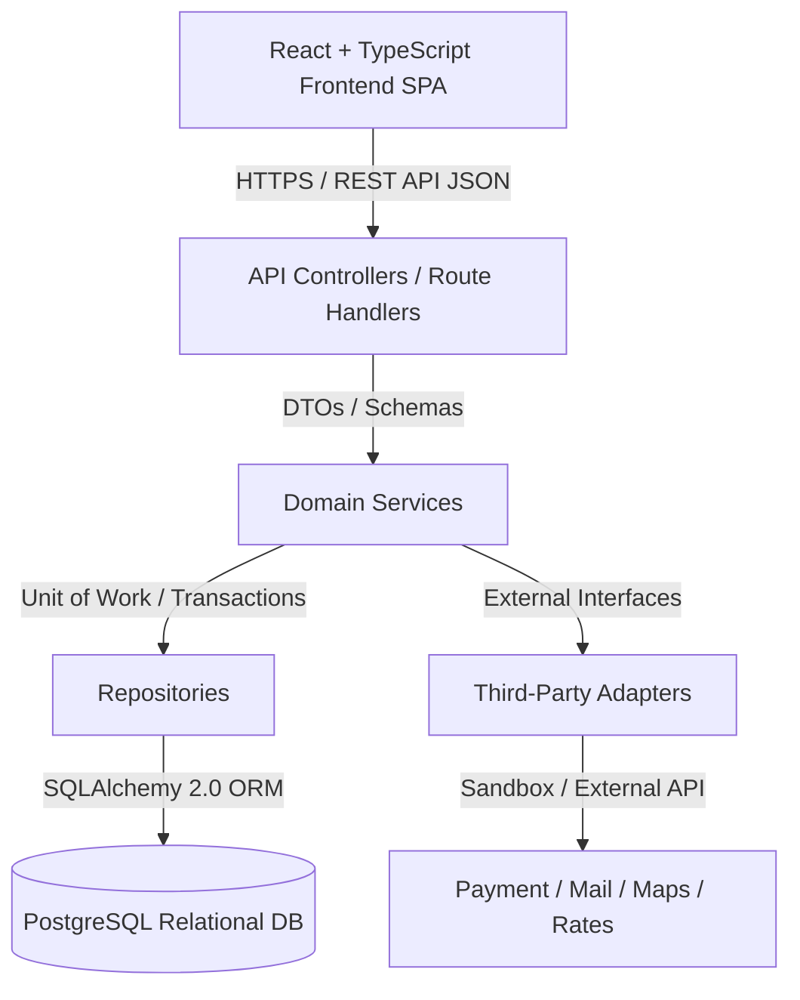

# GlobeStay System Architecture

## 1. Architectural Overview
GlobeStay is engineered as an enterprise-grade, MVC-inspired international accommodation reservation system with dedicated Service and Repository layers. The backend exposes a versioned RESTful API (`/api/v1`) built with FastAPI, SQLAlchemy 2.0, and PostgreSQL. The frontend is a modern single-page application built on React, TypeScript, Tailwind CSS, TanStack Query, and React Router.

## 2. Layer Responsibilities

### View Layer (Frontend)
- **Path**: `frontend/src/`
- **Responsibilities**:
  - Presentation logic, user experience, responsive visual styling.
  - Client-side form handling and validation with `react-hook-form` and `zod`.
  - Asynchronous data fetching, caching, and state synchronization with `@tanstack/react-query`.
  - Strict decoupling: No direct database access or secret storage; communicates solely via HTTP/REST with the backend.

### Controller Layer (Backend)
- **Path**: `backend/app/controllers/` and `backend/app/api/v1/`
- **Responsibilities**:
  - HTTP request parsing, deserialization, and schema validation with Pydantic v2.
  - Authentication and authorization guard enforcement (JWT verification, role permissions).
  - Invoking domain services and mapping responses/exceptions into proper HTTP status codes (200, 201, 400, 401, 403, 404, 409, 422, 500).

### Service Layer (Business Logic)
- **Path**: `backend/app/services/`
- **Responsibilities**:
  - Implements all core domain rules (search filtering, pricing calculations with Decimal precision, cancellation policies, hold expiration).
  - Manages atomic transactions across multiple repositories.
  - Implements concurrency-safe room inventory reservations to prevent double-booking.
  - Coordinates payment session creation and authoritative webhook event processing.

### Repository Layer (Data Access)
- **Path**: `backend/app/repositories/`
- **Responsibilities**:
  - Encapsulates database queries and persistence logic using SQLAlchemy 2.0 Select statements.
  - Enforces row-level locking (`with_for_update`) during inventory holds and status transitions.
  - Isolates data storage concerns from business rules.

### Model Layer (Persistence Entities)
- **Path**: `backend/app/models/`
- **Responsibilities**:
  - Defines relational tables, columns, indexes, foreign keys, and constraints.
  - Maintains domain integrity through database constraints (e.g. unique composite key on `(room_type_id, stay_date)`).

### Integration Adapters
- **Path**: `backend/app/integrations/`
- **Responsibilities**:
  - Pluggable interfaces (Abstract Base Classes) for payments, inventory suppliers, exchange rates, maps, and transactional emails.
  - Supports sandbox/mock implementations out-of-the-box for safe local development and testing, with zero risk of processing live payments or sending unauthorized notifications.

## 3. Concurrency and Anti-Overbooking Mechanism
1. When a reservation hold is requested, a database transaction is opened.
2. The inventory records for the target `room_type_id` spanning `check_in` through `check_out - 1` are locked using a consistent ordering (sorted by date) to eliminate deadlocks.
3. Availability condition: `total_rooms - (booked_rooms + held_rooms) >= requested_rooms`.
4. If satisfied, `held_rooms` is incremented and a hold record with `expires_at` (default: 15 minutes) is generated atomically.
5. If payment fails or the hold expires, background reconciliation releases the held rooms without touching confirmed bookings.
