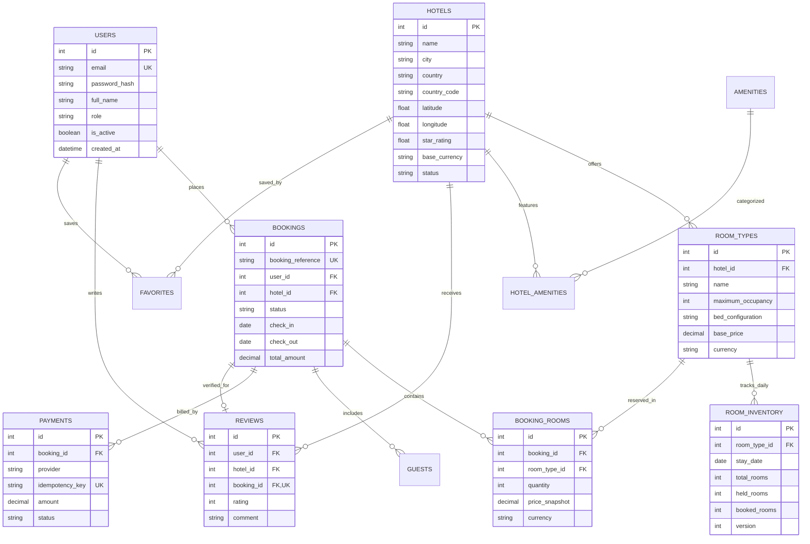

# GlobeStay Database Schema Specification

This document details the relational schema, tables, constraints, foreign keys, and indexes implemented in GlobeStay.

## Integrity Constraints
1. **Zero Overbooking Composite Uniqueness**:
   `room_inventory` enforces `UniqueConstraint("room_type_id", "stay_date", name="uq_room_type_stay_date")`. Daily inventory per room type cannot be duplicated or bypassed.
2. **One Verified Review Per Booking**:
   `reviews.booking_id` has a unique foreign key constraint ensuring that each completed reservation can only produce a single verified review.
3. **Idempotent Payment Processing**:
   `payments.idempotency_key` is unique and indexed, preventing double-charging or duplicate webhook recording.
4. **Historical Price Snapshot**:
   `booking_rooms.price_snapshot` freezes the room rate agreed at the time of reservation. Subsequent changes to `room_types.base_price` never alter historical or confirmed bookings.
